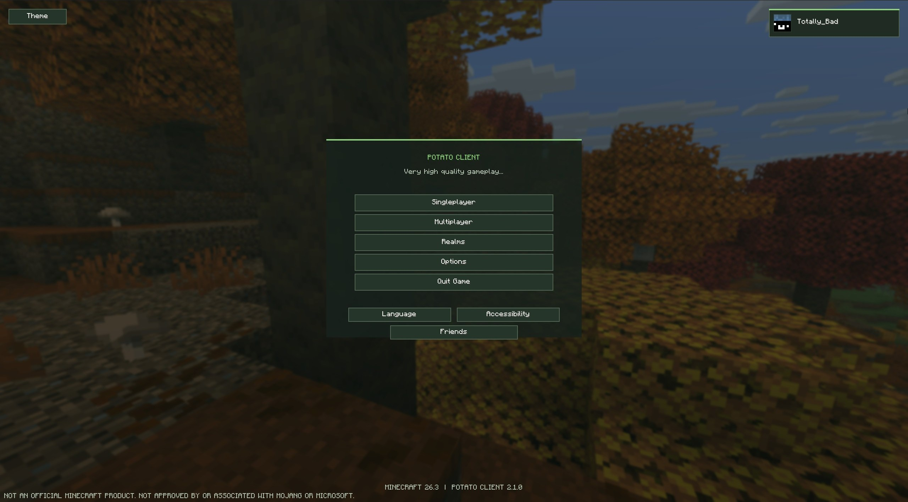
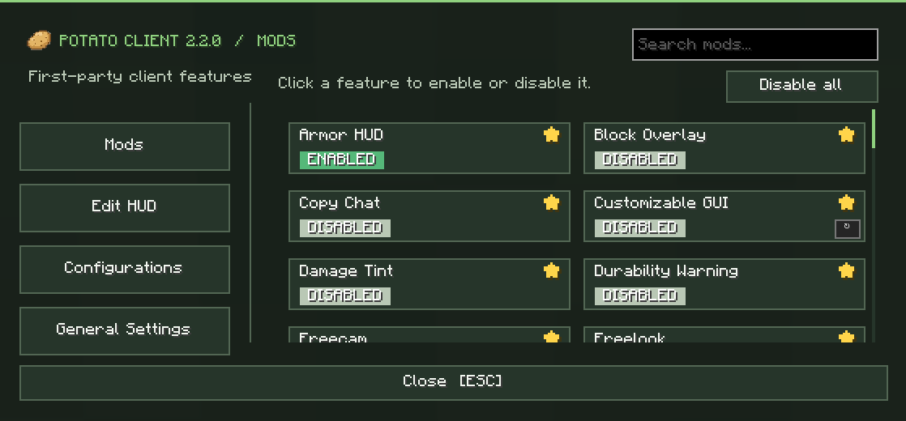
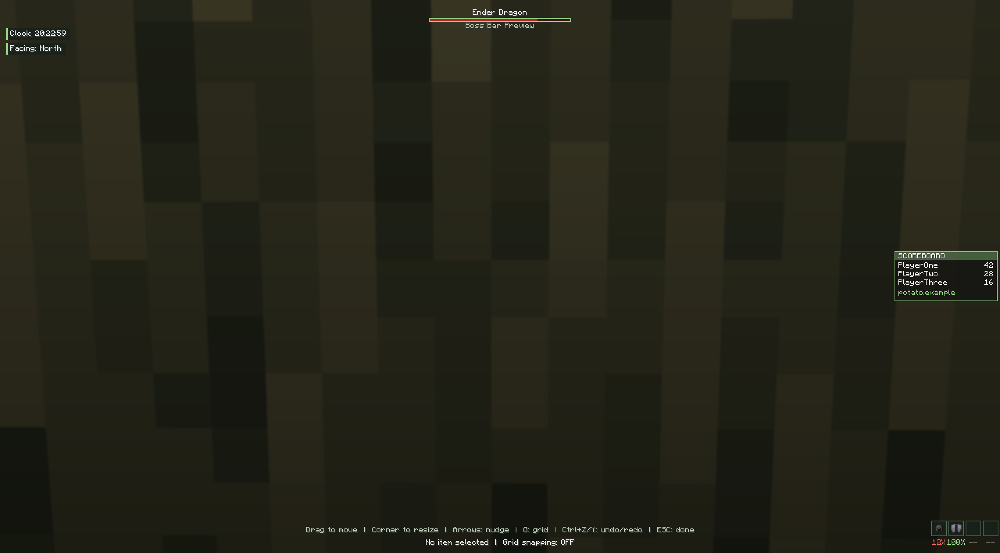

<h1> Potato Client</h1>

**Potato Client 2.2.0 — Minecraft client release repository**

Welcome to the official download repository for Potato Client. This repository is intended for releases and public-facing client information, not website hosting.

## Download Potato Client 2.2.0

The latest release is available now.

- **[Download Potato Client installer (JAR)](https://github.com/TotalllyBad/potatoclient/releases/download/Potato-Client/potato-client-installer-2.2.0.jar)**
- [View release details and version notes](https://github.com/TotalllyBad/potatoclient/releases/tag/Potato-Client)

## About Potato Client

Potato Client is a Minecraft client project. This repository is the home for its public release downloads, version information, screenshots, and installation notes.

## Installation

1. Download the official Potato Client 2.2.0 JAR using the link above.
2. Follow the installation instructions supplied with the client.
3. Only download releases published by this repository's maintainers.

## Socials

- **Discord:** [Join the Potato Client Discord](https://discord.gg/BrRtTf5gWB)
- **YouTube:** [@potatoclient](https://www.youtube.com/@potatoclient)

## Client screenshots

  

  

  

## Legal notice

Potato Client is an independent third-party project and is **not affiliated with, endorsed by, sponsored by, or associated with Mojang Studios or Microsoft**. Minecraft is a trademark of Microsoft Corporation. All Minecraft names, trademarks, and related assets remain the property of their respective owners.

**Copyright Potato Client. All rights reserved.** This notice does not claim ownership of Minecraft or third-party intellectual property.

## Repository privacy

This repository is public, so all committed files and their Git history can be viewed by anyone. Do not put private source code, credentials, or personal files here. Keep those in a separate private repository.
